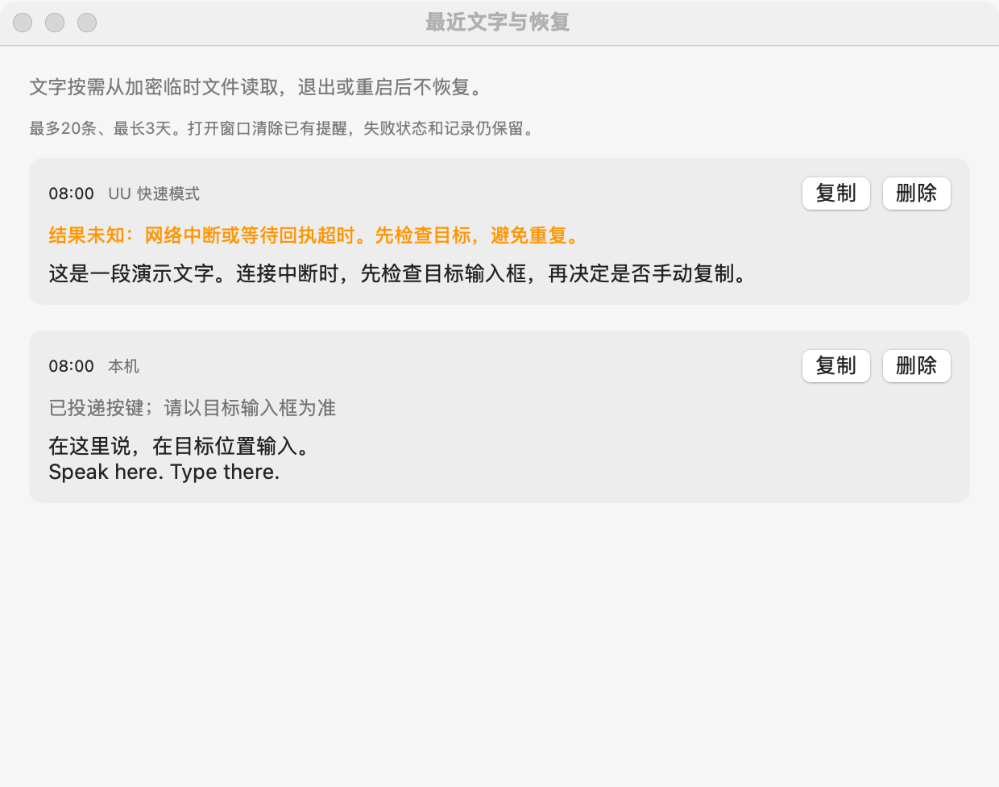

<p align="center"></p>

# SayRoute

**Speak here. Type there.**

A native macOS dictation companion that delivers confirmed text to your local app or a remote Mac through NetEase UU Remote. SayRoute currently drives the **installed Doubao Input Method**; it is not a standalone speech-recognition engine or an official Doubao integration.

**English** · [简体中文](README.zh-CN.md)

> **SayRoute 1.4.0** includes configurable dictation shortcuts and per-device UU fast routing for multiple Macs. [Download the macOS release](https://github.com/devon-kong/sayroute/releases/tag/v1.4.0)

Rendered directly from the current SwiftUI/AppKit components with sample text; controls are not redrawn. Light and dark variants follow the page theme.

**Dictation overlay:** waits for the input method to commit the final text, retaining it if the wait times out.

<p align="center">
<picture>
  <source media="(prefers-color-scheme: dark)" srcset="docs/visuals/sayroute-overlay-dark.png">
  
</picture>
</p>

**Recent text and recovery:** shows delivery status and recoverable text. Check the destination before copying an unknown result to avoid duplicate input.

<p align="center">
<picture>
  <source media="(prefers-color-scheme: dark)" srcset="docs/visuals/sayroute-recovery-dark.png">
  
</picture>
</p>

## What it does

- Captures your target app, waits for the input method to commit its text, then restores the target and delivers it.
- Routes each session through local paste, UU clipboard synchronization, or a bridge on the controlled Mac.
- Keeps recoverable text when a session times out or delivery fails; an uncertain delivery is never automatically retried.
- Places the dictation panel near the pointer or at the top of the screen.

| Route | Best for | Delivery |
| --- | --- | --- |
| Local | Apps on this Mac | Restore target, copy text, post `⌘V` |
| UU compatibility | Remote Mac, without a helper | UU clipboard synchronization plus paste; adjustable settling delay |
| UU fast | Remote Mac with SayRoute Bridge | Send text through a UU port mapping; the remote bridge writes its clipboard and posts `⌘V` |

## Requirements and installation

- macOS 13 or later; Doubao Input Method installed and enabled on the **controller**.
- Accessibility permission for `SayRoute.app`. Fast mode additionally needs a remote Mac, NetEase UU Remote, its port mapping, and Accessibility for `sayroute-bridge` on that Mac.
- Universal builds include Apple Silicon and Intel slices. Runtime acceptance on Intel is not established by compilation.
- Packages use ad-hoc signing and are **not Apple-notarized**. Automatic installation stays disabled for these signatures; update manually using a verified package.

Install the controller from `SayRoute-v1.4.0.dmg` or `SayRoute-v1.4.0.zip`. For fast mode, use `sayroute-bridge-macos-v1.4.0-build20.zip` on the controlled Mac. SHA-256 checksums accompany each download. [Release downloads](https://github.com/devon-kong/sayroute/releases/tag/v1.4.0)

Unzip the controller package and place `SayRoute.app` in Applications. If upgrading from Doubao Murmur, **copy any needed recovery text before quitting the old app**, then follow the [migration and rollback guide](docs/sayroute-migration.md). The new bundle identity needs its own Accessibility grant.

For fast mode, install the companion package on the **controlled Mac** using the [bridge guide](packaging/sayroute-bridge/README.md). Keep each Bridge on `127.0.0.1:17771`. In controller build 26, give each Mac a distinct local port in UU (such as 17771 or 17772), then register the ports in the SayRoute menu under **设备与端口**. Confirm existing single-Mac mappings once when upgrading.

UU supplies the device name automatically. You can give it a local display name. Fast mode learns the device when its name appears in a regular UU window. With two fullscreen sessions, press the same hotkey in the desired window. Switching Spaces during dictation keeps the original target. If SayRoute starts after a window is already fullscreen, leave fullscreen until its device name appears, then return. Window detection uses Accessibility notifications and needs no screen recording. The overlay and recovery history show the destination captured for that recording. SayRoute uses the bundled UU CLI and Accessibility to match the window to a connected device and rechecks the connection before sending. Unidentified, ambiguous, disconnected or unbound destinations leave the text in recovery. Older v2 Bridges can omit build information. Save the binding again after renaming a device or changing its UU mapping.

## Dictate

1. Put the caret in the destination field. For a pointer-following panel, position the pointer nearby.
2. Press the start shortcut once (default `Control + /`; record, test, or reset it in Settings → General). SayRoute waits for the shortcut to be released, the panel to focus and Doubao IME to become ready, then sends right Command to start dictation.
3. Speak, then **physically press right Command once** to stop Doubao dictation.
4. SayRoute waits for the IME's underlined composition to finish before freezing and delivering the text.

| Key | Action |
| --- | --- |
| Start shortcut while idle | Start |
| Start shortcut while recording | Ignored |
| Physical right Command while recording | Stop gesture |
| `Esc` | Cancel without copying or pasting; restore the previous input source |

Settings → General shows Accessibility permission, the actual global shortcut listener state with a retry action, and Doubao input-source availability. Devices & Ports checks the UU connection, Bridge health and remote Accessibility separately. General also offers panel position, UU paste route and clipboard settling time. These three preferences migrate once from the old official app when valid; existing SayRoute preferences win.

## Recovery, privacy and limits

- After a stop gesture, 1.5 seconds triggers a waiting notice. If commitment is still unconfirmed after 15 seconds, or focus/stop handling is interrupted, automatic paste stops and a recoverable draft is retained.
- **Recent text & recovery** (`最近文字与恢复`) holds up to 20 entries for up to three days **within the running session**. Text is encrypted in temporary local files; the key is never persisted. Quitting/restarting loses access to these drafts. Copying does not delete an entry.
- SayRoute does not send text to an ASR API. Doubao Input Method performs recognition and may use its own network services; its privacy terms apply. Fast mode sends text to the configured remote bridge.
- `eventPosted=true` means that a key event was posted. It does **not** prove that the target editor inserted text. For “unknown” results, inspect the destination before trying again to avoid duplicates.
- The bridge has **no authentication or remote target binding**. It is for trusted loopback and UU mappings only. Do not expose it to a LAN or the public internet.
- Diagnostic event databases live under `~/Library/Application Support/SayRoute/`; controller/helper databases record event metadata, not dictated text. Recovery ciphertext is under `~/Library/Caches/SayRoute/RecoverySessions/`. Legacy data stays in its original directories for rollback.

## Build and verify

Use Xcode 15+ and [XcodeGen](https://github.com/yonaskolb/XcodeGen).

```bash
export DEVELOPER_DIR=/Applications/Xcode.app/Contents/Developer
swift test
python3 scripts/test-bridge-installer.py
scripts/package-app.sh --candidate
scripts/package-sayroute-bridge.sh --candidate
```

The Python test runner is a development dependency, not an app/installer dependency. Tests use isolated settings and service fixtures; they do not invoke global hotkeys or paste into real apps. Candidate archives include `-candidate` in their names and working-tree provenance. To build release archives from a clean committed tree, omit `--candidate`. CI runs tests and universal packaging; `v*` tags publish only after those jobs succeed. Real dictation acceptance is a separate release gate documented in [acceptance status](docs/sayroute-acceptance.md).

App packaging keeps the updater-compatible ZIP and also creates a drag-to-Applications DMG, SHA-256 checksums, shared build-info and a source manifest. It requires a logged-in Finder session. For an independent DMG-only build/test (without rebuilding the app), layout details and final-build instructions, see [macOS packaging](docs/packaging.md).

## Origin and license

SayRoute evolved from [lilong7676/doubao-murmur](https://github.com/lilong7676/doubao-murmur). The original copyright and [MIT license](LICENSE) remain. Devon Kong developed the installed-IME session flow, UU routing/bridge, recovery and delivery reliability work; some application, hotkey and update scaffolding derives from the original project. See [attribution and implementation history](ATTRIBUTION.md).

MIT permits commercial use subject to its conditions. Third-party input methods and remote-control software have their own terms. SayRoute is independent of, and not endorsed by, Doubao or NetEase.
