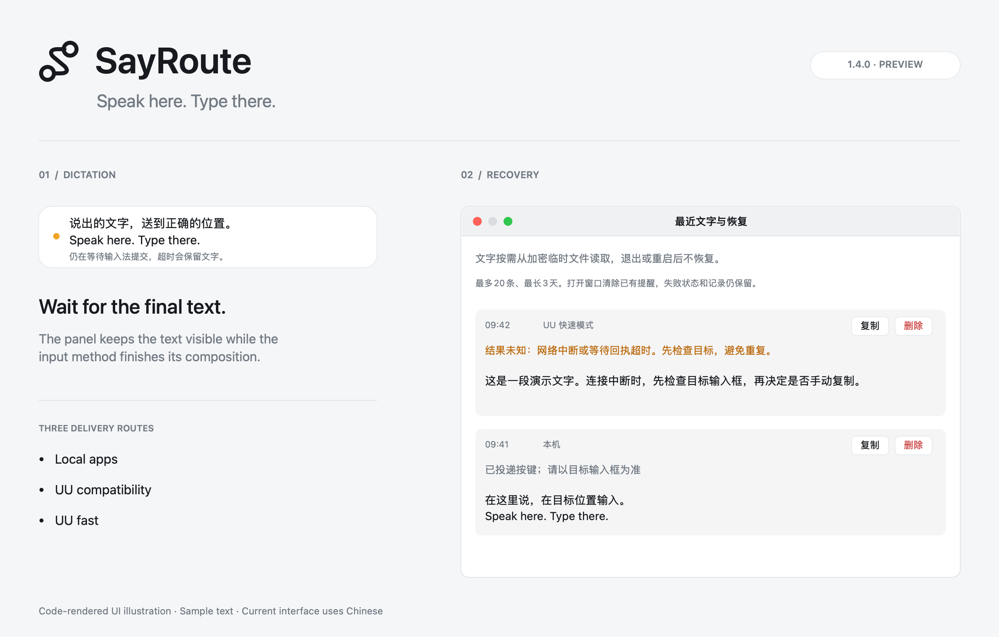

<p align="center"></p>

# SayRoute

**Speak here. Type there. — 在这里说，在目标位置输入。**

原生 macOS 语音输入辅助工具：等待识别文字提交，再送到本机应用或网易 UU 远控中的另一台 Mac。当前依赖控制端**已安装并启用的豆包输入法**，不是独立语音识别引擎，也不是豆包官方集成。

[English](README.md) · **简体中文**

> **1.4.0 RC 1 预发布版**：控制端 build21、SayRoute Bridge build20。[下载 SayRoute 预发布版](https://github.com/devon-kong/sayroute/releases/tag/v1.4.0-rc.1)。真实输入尚待验收，未标为正式版。详见[验收状态](docs/sayroute-acceptance.md)。上一个正式版为 Doubao Murmur 1.3.1。

<p align="center"></p>
<p align="center"><em>根据当前界面代码绘制的示意图，内容为演示文字。当前应用界面使用中文。</em></p>

## 解决什么问题

- 开始时记录目标应用，等待输入法明确提交文字后恢复目标并投递。
- 每轮按已确定的路由执行本机粘贴、UU 剪贴板同步或远端直写。
- 超时或失败时保留可恢复文字；状态未知时不自动重试，降低重复输入风险。
- 输入框可跟随鼠标坐标，也可固定在屏幕上方。

| 模式 | 适用场景 | 投递方式 |
| --- | --- | --- |
| 本机 | 当前 Mac 上的应用 | 恢复目标，复制文字并投递 `⌘V` |
| UU 兼容 | 未安装远端 helper 的远程 Mac | UU 正常剪贴板同步后粘贴，可调稳定等待时间 |
| UU 快速 | 已安装 SayRoute Bridge 的远程 Mac | 经 UU 端口映射发送文字，由远端写入剪贴板并投递 `⌘V` |

## 环境和安装

- macOS 13.0+；**控制端**安装并启用豆包输入法。
- 为 `SayRoute.app` 授予辅助功能权限。快速模式还需另一台 Mac、网易 UU 远控、端口映射，以及被控端 `sayroute-bridge` 的辅助功能权限。
- 通用构建包含 Apple Silicon 和 Intel；编译通过不代表已经完成 Intel 实机验收。
- 当前使用 ad-hoc 签名，**未做 Apple 公证**；此签名不启用自动安装更新，请核验安装包后手动更新。

下载 [SayRoute 1.4.0 RC 1](https://github.com/devon-kong/sayroute/releases/tag/v1.4.0-rc.1)：控制端使用 `SayRoute-v1.4.0-rc.1.zip`，被控端使用 `sayroute-bridge-macos-v1.4.0-build20.zip`。此前 v1.3.1 保留为 Doubao Murmur 历史版本。

解压控制端安装包，将 `SayRoute.app` 放入“应用程序”。从 Doubao Murmur 升级时，**先复制需要保留的恢复文字，再退出旧应用**，然后按[迁移与回退说明](docs/sayroute-migration.md) 操作。新 Bundle ID 需要单独授予辅助功能权限。

快速模式须在**被控端**安装配套组件，见 [Bridge 安装说明](packaging/sayroute-bridge/README.zh-CN.md)。服务只监听 loopback；UU 映射为控制端 `127.0.0.1:17771` → 被控端 `127.0.0.1:17771`。

## 使用步骤

1. 把光标放到目标输入框；跟随鼠标模式下，将鼠标移到附近。
2. 按一次 `Control + /`。应用等待热键完全释放、悬浮窗聚焦和豆包输入法就绪，再合成右 Command 开始输入。
3. 说完后，**手动按一次物理右 Command** 停止豆包。
4. 等待输入法下划线消失，应用再冻结并投递最终文字。

| 按键 | 行为 |
| --- | --- |
| 空闲时 `Control + /` | 开始 |
| 录音中 `Control + /` | 忽略 |
| 录音中物理右 Command | 停止手势 |
| `Esc` | 取消，不复制或粘贴，恢复原输入法 |

菜单提供输入框位置、UU 粘贴模式和剪贴板稳定时间。这三项有效偏好会从旧正式版迁移一次；已有的 SayRoute 设置优先。

## 恢复、隐私与边界

- 停止后 1.5 秒提示等待；15 秒仍未确认提交，或失焦、停止手势中断时，停止自动粘贴并保留草稿。
- “最近文字与恢复”最多保留 20 条、最长三天，且仅限**当前运行会话内**。原文加密暂存，密钥不落盘；退出或重启后无法恢复。复制不会删除条目。
- SayRoute 不调用 ASR API 上传文字；豆包输入法执行识别，可能使用自己的网络服务，其隐私规则仍适用。快速模式会向配置的远端 Bridge 发送文字。
- `eventPosted=true` 仅表示已投递按键，不证明目标编辑器插入成功。显示“状态未知”时先检查目标，避免重复输入。
- Bridge **没有身份认证和远端目标绑定**，只适合可信本机 loopback 与 UU 映射，不能开放到局域网或公网。
- 订单事件数据库位于 `~/Library/Application Support/SayRoute/`，记录事件元数据，不记录识别原文。恢复密文位于 `~/Library/Caches/SayRoute/RecoverySessions/`。旧版目录原位保留，供回退使用。

## 构建与验证

需要 Xcode 15+ 和 [XcodeGen](https://github.com/yonaskolb/XcodeGen)。

```bash
export DEVELOPER_DIR=/Applications/Xcode.app/Contents/Developer
swift test
python3 scripts/test-bridge-installer.py
scripts/package-app.sh --candidate
scripts/package-sayroute-bridge.sh --candidate
```

Python 仅用于开发测试，应用和安装器不依赖 Python。测试使用隔离偏好与服务夹具，不监听真实全局快捷键或向真实应用粘贴。候选包文件名含 `-candidate` 并附工作区来源信息；正式包须在干净且已提交的源码上省略该参数构建。CI 执行测试与通用构建，`v*` 标签通过后发布。真实语音输入是独立发布验收项，见[验收状态](docs/sayroute-acceptance.md)。

## 来源与许可

SayRoute 源自 [lilong7676/doubao-murmur](https://github.com/lilong7676/doubao-murmur)，保留原版权与 [MIT 许可证](LICENSE)。Devon Kong 开发了当前输入法会话流程、UU 路由与 Bridge、恢复与可靠投递机制；应用、热键和更新部分框架仍有原项目来源，见[署名与实现历史](ATTRIBUTION.md)。

MIT 允许在满足条件的情况下商业使用。第三方输入法和远控软件受各自条款约束。本项目独立于豆包及网易，未获其背书。
